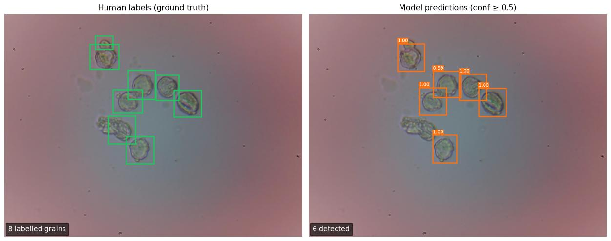

# Automated Pollen Detection with an Affordable Technology

This repository contains the code and hardware design files accompanying the paper [Automated and Continuous Pollen Detection with an Affordable Technology](http://www.ewsn.org/file-repository/ewsn2020/108_119_cao.pdf?attredirects=0&d=1). The data can be found [here](https://zenodo.org/record/3572653) (download instructions provided below).

## Seminar project: Advanced Networked Embedded Systems

This repository was created as part of my seminar in **Advanced Networked Embedded Systems**, where I studied the paper above and reproduced its pollen detection results. The method, hardware design, dataset and trained model are the work of the original authors (Cao, Meyer, Thiele, Saukh); the original repository is [osaukh/pollenpub](https://github.com/osaukh/pollenpub).

📖 **[Read the full documentation](docs/README.md)**: how the system works end to end, from the pollen trap and the microscope images to the YOLOv3 model, training, evaluation and step-by-step reproduction.



**My contributions**
- Ported the code from Python 3.7 / PyTorch 1.x to current Python (3.12, 3.14) and PyTorch 2.x, fixing the incompatibilities this exposed (tensor indexing, image mode handling, NaN loss on batches without labels).
- Rewrote the dataset downloader to resume dropped connections and fetch only part of the archive (`--only pollen_20190523` fetches the 626MB test set without the full 1.6GB zip).
- Added a pip `requirements.txt` and CPU setup instructions, and reduced checkpoint disk usage during training.
- Re-ran the evaluation of the published model on the `pollen_20190523` test set (3,769 images) on a CPU-only machine.

**Reproduced results** (published weights `pollen_20190526.pth`, IoU 0.5, confidence 0.5; full log in [results/](results/))

| Class | AP | F1 |
|---|---|---|
| pollen | 0.899 | 0.875 |

The labels also contain a `maybe` class (uncertain objects), but the published model was trained with a single class (`classes=1` in [yolov3-pollen.cfg](code/config/yolov3-pollen.cfg)), so it never predicts `maybe` and its AP is 0 by construction. The pollen AP is the meaningful score.

## Bibtex citation
```
@inproceedings{namcao2020pollen,
  title = {Automated Pollen Detection with an Affordable Technology},
  author = {Nam Cao and Matthias Meyer and Lothar Thiele and Olga Saukh},
  booktitle = {Proceedings of the International Conference on Embedded Wireless Systems and Networks (EWSN)},
  pages={108–119}
  month = {2},	
  year = {2020},
}
```

## Hardware designs
The [./hwdesign/](./hwdesign/) folder contains the design files for the automated pollen trap. For more information please refer to the paper.

## Code
The paper's results can be reproduced with the following guideline.

### Requirements
To use the code, you require the following tools as prerequisites:
* Python 3.7
* git
    
We recommend Anaconda or Miniconda, the latter being a minimal (but sufficient) version of the Anaconda distribution. The following instructions will be based on Miniconda. If you use another Python environment, the installation routine must be adapted.

Note: The code was only tested on Linux. Using Windows might lead to problems during installation of packages. If you get it to run on Windows please create a pull request with instructions/required changes.

### Modern setup (pip, CPU or GPU)
The pinned conda environment below targets Python 3.7 + CUDA 10.1 and no longer resolves on current systems. The code has been updated to run on current Python (tested on 3.12 and 3.14) with PyTorch 2.x (tested on 2.15):

```
python3 -m venv .venv
.venv/bin/pip install torch torchvision --index-url https://download.pytorch.org/whl/cpu   # drop --index-url for the CUDA build
.venv/bin/pip install -r code/requirements.txt
cd code/
../.venv/bin/python utils/download.py                                     # resumable download + extract
../.venv/bin/python utils/download.py -f data.zip --only pollen_20190523   # test set only (626MB)
../.venv/bin/python test.py --weights_path ../weights/pollen_20190526.pth --model_def config/yolov3-pollen.cfg --data_config config/test_20190523.data --batch_size 8
```

On a 4-core CPU with 12GB RAM, evaluating the full test set (3769 layers) takes ~30 min at `--batch_size 8`; the default of 16 can exhaust memory and swap. Training is only practical on a GPU. `train.py` now keeps only `checkpoints/<name>_last.pth` and `<name>_best.pth` (pass `--keep_all_checkpoints` for the old one-per-epoch behaviour, ~246MB each) and logs to `logs/<name>/metrics.csv`. Use `--max_batches N` for a quick smoke run.

### Quickstart
After the installation of Anaconda, open a terminal (on Windows Anaconda Prompt) and create a new environment by typing:


##### Clone repository and install requirements
```
git clone https://github.com/osaukh/pollenpub
cd code/
conda env create -f environment.yml
```

Note: The following commands are to be run from the `code/` directory.

##### Download weights and pollen images
```
python utils/download.py -f weights.zip data.zip
```

##### Run the test
```
python test.py --weights_path ../weights/pollen_20190526.pth --model_def config/yolov3-pollen.cfg --data_config config/test_20190523.data
```

##### Run object detection on any image
Change the `--image_folder` argument to an image directory which contains pollen images and detect pollen images with the following command:

```
python detect.py --image_folder ../data/pollen_20190523/layers/ --output_folder ../tmp/output/ 
```

### Training
Training on the provided dataset can be done by issuing the following command

```
python train.py --name fold0 --epochs=60 --model_def config/yolov3-pollen.cfg --data_config config/train_20190526fold0.data --pretrained_weights ../weights/darknet53.conv.74
```

#### Prepare new pollen training sets
The create_folds.py script can be used to prepare the image folders to be used with the training script.
It creates one/multiple text files which can be used for training/testing. Each file contains the name of the images belonging to the train/val set. The script takes into account that each sample consists of multiple depth layers since it is important that all depth layers of a sample are either in train or val set. This avoids information leakage between test and val,

Note: The following commands need only to be exectuted if you want to use a new labeled image folder for training. The files produced by these commands are already in [./config/](./config/).

After preparing the data you can run the training procedure as described before but with updated `--data_config` parameter.

##### Create training an validation set
```
python create_folds.py -f ../data/pollen_20190526/ -o ../data/pollen_20190526/ -K 5 -n train_20190526
```

##### Create test set
```
python create_folds.py -f ../data/pollen_20190523/ -o ../data/pollen_20190523/ -n test_20190523
```


### Credit

#### PyTorch-YOLOv3 repository
Thanks to [Erik Linder-Norén](https://github.com/eriklindernoren/) who open sourced his [YOLOv3 code](https://github.com/eriklindernoren/PyTorch-YOLOv3) on which this implementation is based.

#### YOLOv3: An Incremental Improvement
_Joseph Redmon, Ali Farhadi_ <br>

[[Paper]](https://pjreddie.com/media/files/papers/YOLOv3.pdf) [[Project Webpage]](https://pjreddie.com/darknet/yolo/) [[Authors' Implementation]](https://github.com/pjreddie/darknet)

```
@article{yolov3,
  title={YOLOv3: An Incremental Improvement},
  author={Redmon, Joseph and Farhadi, Ali},
  journal = {arXiv},
  year={2018}
}
```


