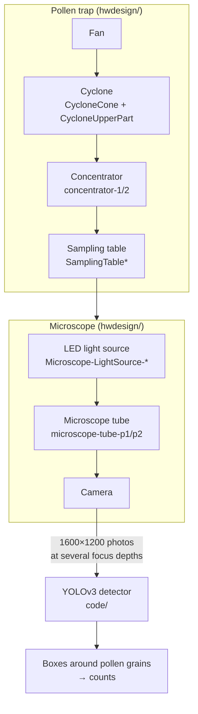

# 1. System and hardware

[← Index](README.md) · [Next: Dataset →](02-dataset.md)

## The problem

Airborne pollen is monitored because it triggers allergies in a large share of the population. The standard method is a volumetric trap (Hirst type): a pump pulls air across a slowly moving sticky tape, the tape is collected by hand about once a week, and a trained palynologist counts grains under a lab microscope. This is accurate but slow (results arrive days later), labour intensive and expensive, so measuring stations are sparse.

The paper's question: **can pollen be detected automatically and continuously with affordable, mostly 3D-printed hardware and a neural network?** That would make dense, real-time networks of pollen sensors possible, which is why this work sits in the networked embedded systems field.

## System overview

The system has three parts.

### 1. Collection: cyclone and concentrator

Files: [hwdesign/CycloneCone.stl](../hwdesign/CycloneCone.stl), [CycloneUpperPart.stl](../hwdesign/CycloneUpperPart.stl), [concentrator-1.stl](../hwdesign/concentrator-1.stl), [concentrator-2.stl](../hwdesign/concentrator-2.stl), and a variant in [hwdesign/pollen_collector/](../hwdesign/pollen_collector/).

A fan mounted on top pulls air through the cyclone. In a cyclone separator, the air spins along the cone wall; heavier particles such as pollen grains (roughly 10 to 100 µm) cannot follow the tight curve and are thrown outward and down, while the cleaned air leaves through the top. The concentrator directs the separated particles onto a small area of the sample surface, so the microscope only needs to look at a small spot.

### 2. Positioning: sampling table

Files: [SamplingTable-120.stl](../hwdesign/SamplingTable-120.stl), [SamplingTableBase.stl](../hwdesign/SamplingTableBase.stl), [SamplingTableBallHolder.stl](../hwdesign/SamplingTableBallHolder.stl).

The sampling table holds the sample surface on which the particles are collected and positions it under the microscope. See the paper for the mechanism.

### 3. Imaging: low-cost microscope

Files: [Microscope-LightSource-LedBase.stl](../hwdesign/Microscope-LightSource-LedBase.stl), [Microscope-LightSource-LensTube.stl](../hwdesign/Microscope-LightSource-LensTube.stl), [Microscope-LightSource-MagnetBase.stl](../hwdesign/Microscope-LightSource-MagnetBase.stl), [microscope-tube-p1.stl](../hwdesign/microscope-tube-p1.stl), [microscope-tube-p2.stl](../hwdesign/microscope-tube-p2.stl).

An LED light source illuminates the sample. The images show transmitted light (light passing through the sample), which is why the background is bright and the grains appear as outlined, translucent shapes. A printed tube holds the optics and the camera, and the camera produces 1600×1200 colour images.

The `.stl` files can be opened in any 3D viewer (GitHub previews them directly) or loaded into a slicer for printing. The paper describes the assembly, the electronics and the exact parts; this repository contains the printable parts.

## Why the images need a neural network

A cheap microscope at this magnification has a very shallow depth of field: only a thin slice of the sample is sharp at a time. Pollen grains are 3D, sit at different heights, and are mixed with dust, soot, fibres and air bubbles. The system therefore photographs each spot at several focus depths, and the detector has to:

- recognise pollen grains whether they are sharp, slightly blurred or partly out of focus,
- ignore non-pollen particles,
- cope with grains that touch or overlap.

Hand-written rules (thresholding, circle detection) break down on these images, which is why a learned object detector is used. [Chapter 2](02-dataset.md) describes the images in detail.

## Where the computation happens

The detector is a large network (about 62 million parameters, a 246 MB weights file). In this repository it runs offline on a PC: on a 4-core laptop CPU it processes about 2 images per second, and on a GPU much faster. In a deployed system the images would be sent from the trap to a server for detection, or a smaller network would run on the device.
