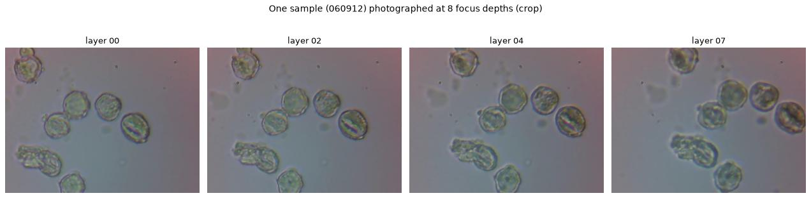

# 2. Dataset

[← System and hardware](01-system-and-hardware.md) · [Index](README.md) · [Next: The model →](03-model.md)

The data was recorded with the trap from [chapter 1](01-system-and-hardware.md) and labelled by hand. It is published on [Zenodo (record 3572653)](https://zenodo.org/record/3572653) as `data.zip` (1.6 GB) and is **not** stored in this Git repository; [chapter 6](06-reproduce.md) shows how to download it.

## Two recording days

| Folder | Recorded | Used for | Size |
|---|---|---|---|
| `pollen_20190526` | 26 May 2019 | Training (5-fold cross-validation) | 966 MB |
| `pollen_20190523` | 23 May 2019 | Testing | 626 MB |

The model was trained on one day and tested on a different day. This is a stricter test than a random split of a single day: particle mix, lighting and slide preparation differ between days, so a good test score shows the detector generalises instead of memorising one session.

## Focus stacks: samples and layers

Each spot on the slide is photographed several times at different focus depths. One photo is a **layer**; all layers of one spot form a **sample** (also called a stack).


*The same grains in 4 of the 8 layers of sample 060912. Different grains, and different parts of each grain, are sharp in different layers.*

File names encode both:

```
060912-03.jpg
└─┬──┘ └┬┘
sample  layer
```

Test set (`pollen_20190523`) statistics:

| | |
|---|---|
| Samples | 506 |
| Layers (images) | 3,769 |
| Layers per sample | 2 to 26, average 7.4 |
| Image size | 1600 × 1200 px, RGB JPEG |
| Layers containing at least one label | 1,982 (53%) |
| Labelled boxes | 3,114 (2,428 `pollen`, 686 `maybe`) |
| Typical box size | about 189 × 182 px (median), range 49 to 722 px wide |

## Folder layout

```
data/pollen_20190523/
├── layers/              one JPEG per layer
│   ├── 000104-00.jpg
│   ├── 000104-01.jpg
│   └── ...
├── labels/              one text file per layer that has labels (same name, .txt)
│   ├── 000104-00.txt
│   └── ...
├── classes.names        class names, one per line: "pollen", "maybe"
├── test.txt             list of all layers (relative paths) used for testing
└── fold0_train.txt ...  cross-validation splits (see below)
```

A layer with no file in `labels/` has no labelled objects; the loader treats it as an image with zero boxes. Such images are still useful, because they teach the model what background looks like.

## Label format (YOLO format)

Each line of a label file describes one box:

```
0 0.3453125 0.5154166 0.135625 0.1658333
│ └──┬────┘ └──┬────┘ └──┬───┘ └──┬────┘
│  centre x  centre y   width    height      all as fractions of image width/height
class (0 = pollen, 1 = maybe)
```

So `0.3453125 × 1600 = 552.5` px is the centre x in the original image and `0.135625 × 1600 = 217` px is the width. Fractions keep the labels valid if the image is resized.

**Classes:**

- `0` **pollen**: a grain the labeller was confident about.
- `1` **maybe**: something that might be pollen (blurred, partly hidden, damaged).

The published model was trained with a single class (pollen). Why `maybe` therefore always scores 0, and why that doesn't matter, is explained in [chapter 5](05-evaluation.md#the-maybe-class).

## Train / validation / test splits

Splits are lists of image paths in text files, created by [code/create_folds.py](../code/create_folds.py):

- **Test set:** `pollen_20190523/test.txt` lists all 3,769 layers of 23 May.
- **Training folds:** `pollen_20190526/fold{0..4}_train.txt` and `fold{0..4}_test.txt`. The samples of 26 May are divided into 5 folds; for fold *k*, fold *k* is the validation set and the other four are the training set (5-fold cross-validation).

**Important detail: splits are made per sample, not per layer.** The layers of one sample show the same grains, only focused differently. If layer 3 of a sample were in training and layer 4 in validation, the model would be validated on grains it has effectively already seen, and the validation score would be too optimistic (*data leakage*). `create_folds.py` therefore groups files by sample ID and assigns whole samples to folds (round-robin over the sorted sample IDs: sample *i* goes to fold *i mod K*).

The `.data` files in [code/config/](../code/config/) tie a split together for the scripts:

```ini
# code/config/train_20190526fold0.data
classes= 1
train=../data/pollen_20190526/fold0_train.txt
valid=../data/pollen_20190526/fold0_test.txt
base_dir=../data/pollen_20190526/
names=../data/pollen_20190526/classes.names
```

## Related dataset: pollen library

[pollen_library/](../pollen_library/) describes a separate, later dataset by the same group ([Zenodo 4120033](https://zenodo.org/record/4120033), Graz, 2020): microscope images and videos of 16 pollen types (birch, alder, hazel, grasses, ...) for classifying the *species* of a grain. It is not used by the detector in this repository; [plot_pollen_sample.py](../pollen_library/plot_pollen_sample.py) shows how to load and view it.
