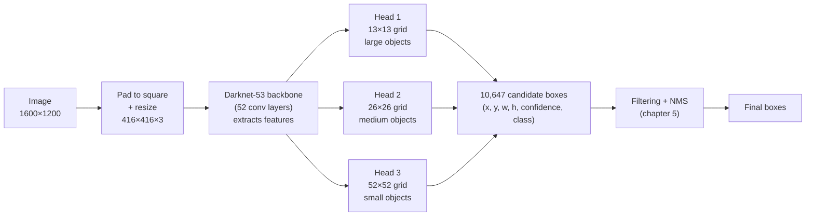

# 3. The model: YOLOv3

[← Dataset](02-dataset.md) · [Index](README.md) · [Next: Training →](04-training.md)

The detector is **YOLOv3** ("You Only Look Once", version 3; Redmon & Farhadi, 2018), set up for a single class. The implementation is based on [Erik Linder-Norén's PyTorch-YOLOv3](https://github.com/eriklindernoren/PyTorch-YOLOv3).

YOLO is a *single-stage* detector: one pass of the network over the image predicts all boxes at once, with no separate step that proposes regions first. That makes it fast and simple, which suits an affordable system.

## The big picture



## Step 1: Input preprocessing

[code/utils/datasets.py](../code/utils/datasets.py) prepares every image the same way:

1. **Load** as RGB and scale pixel values to 0 to 1.
2. **Pad to square** (`pad_to_square`): add black bars above and below, 1600×1200 → 1600×1600. Squashing the image instead would distort the round grains.
3. **Resize** (`resize`) to 416×416. The network's downsampling divides the size by 32, so the input must be a multiple of 32 (416 = 13 × 32).

At 416 px, a typical grain (about 189 px wide in the original) is about 49 px wide.

## Step 2: Backbone, Darknet-53

The network is described layer by layer in a plain-text file, [code/config/yolov3-pollen.cfg](../code/config/yolov3-pollen.cfg) (75 convolutional layers, 23 shortcut, 4 route, 2 upsample and 3 yolo blocks), which [code/models.py](../code/models.py) reads and turns into PyTorch modules (`create_modules`).

The first part, **Darknet-53**, is a stack of convolutional layers with residual ("shortcut") connections. Each convolution is followed by batch normalisation and a LeakyReLU activation. Five times, a convolution with stride 2 halves the resolution:

```
416 → 208 → 104 → 52 → 26 → 13
```

Early layers respond to simple patterns such as edges and colour changes; deeper layers respond to complex shapes like "round object with a thick outline and textured inside". Training starts from Darknet-53 weights pre-trained on ImageNet (millions of everyday photos), which already provide good general-purpose features (`weights/darknet53.conv.74`).

## Step 3: Three detection heads (multi-scale)

YOLOv3 predicts at three resolutions, taken from different depths of the network:

| Head | Grid | Stride (px per cell) | Anchors (w×h px) | Good for |
|---|---|---|---|---|
| 1 | 13 × 13 | 32 | 116×90, 156×198, 373×326 | large objects |
| 2 | 26 × 26 | 16 | 30×61, 62×45, 59×119 | medium objects, **most pollen grains** |
| 3 | 52 × 52 | 8 | 10×13, 16×30, 33×23 | small objects |

The two finer heads use *upsampling* and *route* (concatenation) blocks: the coarse, semantically rich features from deep layers are upsampled and combined with sharper features from earlier layers, so small objects get both detail and context.

## Step 4: Grid cells and anchors

Each head divides the image into a grid. **Each cell is responsible for objects whose centre falls inside it**, and predicts 3 boxes, one per **anchor**. An anchor is a preset box shape; instead of guessing a box from nothing, the network predicts how to shift and stretch its anchor. This is much easier to learn.

For every anchor in every cell, the network outputs 6 numbers (5 + number of classes):

| Output | Meaning | Decoding (`YOLOLayer.forward`) |
|---|---|---|
| t<sub>x</sub>, t<sub>y</sub> | centre offset inside the cell | x = (σ(t<sub>x</sub>) + c<sub>x</sub>) × stride |
| t<sub>w</sub>, t<sub>h</sub> | size relative to the anchor | w = anchor<sub>w</sub> × e<sup>t<sub>w</sub></sup> |
| t<sub>o</sub> | objectness | confidence = σ(t<sub>o</sub>) |
| t<sub>c</sub> | class score | P(pollen) = σ(t<sub>c</sub>) |

σ is the sigmoid function, which squashes any number into 0 to 1, so the centre always stays inside its cell. c<sub>x</sub> is the cell's column index. That is why the last convolution before each head has `filters=18`: 3 anchors × 6 numbers.

**Total candidates per image:**

```
(13² + 26² + 52²) cells × 3 anchors = (169 + 676 + 2704) × 3 = 10,647 boxes
```

Most of these candidates have a confidence near 0 (no object there). [Chapter 5](05-evaluation.md) shows how they are reduced to one box per grain.

## Step 5: Output

The model returns a tensor of shape `[batch, 10647, 6]`: for every candidate, box centre x, centre y, width, height (in pixels of the 416×416 input), confidence and class probability.

## Size of the model

| | |
|---|---|
| Parameters | about 62 million |
| Weights file | 246 MB (`weights/pollen_20190526.pth`) |
| Input | 416 × 416 × 3 |
| Speed on 4-core CPU | about 0.45 s per image (batch of 8) |

## Single class

In the cfg, every `[yolo]` block has `classes=1`, so the model has exactly one output class, *pollen*. The class score is therefore nearly redundant with the confidence: the confidence answers "is there an object here?", and with one class every object is pollen.
