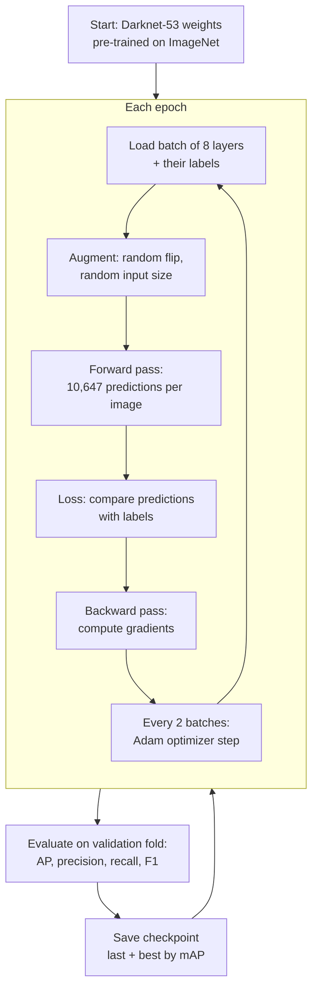

# 4. Training

[← The model](03-model.md) · [Index](README.md) · [Next: Evaluation →](05-evaluation.md)

Training means adjusting the network's 62 million parameters so that its 10,647 predictions per image match the human labels. The published weights (`weights/pollen_20190526.pth`) are the result of this process on the 26 May data. Retraining is not required to use or evaluate the model, and on a CPU it is impractically slow; it needs a GPU.

Script: [code/train.py](../code/train.py).

```bash
cd code/
python train.py --name fold0 --epochs 60 \
    --model_def config/yolov3-pollen.cfg \
    --data_config config/train_20190526fold0.data \
    --pretrained_weights ../weights/darknet53.conv.74
```

## The training loop



## Step by step

### 1. Initialisation

The whole network is first initialised with small random values (`weights_init_normal`). Then the backbone (the first 75 blocks of the `.cfg`, i.e. Darknet-53) is overwritten with **Darknet-53 weights pre-trained on ImageNet** (`load_darknet_weights`, which reads the original Darknet binary format). This is *transfer learning*: the network already knows generic visual features and only has to learn what makes a pollen grain, which needs far less labelled data than learning from scratch.

### 2. Data loading and augmentation

`ListDataset` ([code/utils/datasets.py](../code/utils/datasets.py)) loads each layer and its labels, pads to square and converts box coordinates to fractions of the padded image. Two kinds of augmentation make the model more robust:

- **Horizontal flip** (50% chance, [utils/augmentations.py](../code/utils/augmentations.py)): mirrors the image and the boxes. A mirrored grain is still a grain, so this doubles the variety of the training data for free.
- **Multi-scale training:** every 10 batches the input size is randomly chosen between 320 and 512 px (in steps of 32). The model learns to detect grains at different apparent sizes.

### 3. Assigning labels to predictions (`build_targets`)

For each labelled box, [code/utils/utils.py](../code/utils/utils.py) `build_targets` decides which prediction should match it:

1. Find the grid cell that contains the box centre.
2. Find the anchor whose shape best matches the box (highest IoU of width/height).
3. That one cell/anchor slot becomes **responsible** for the object (`obj_mask`). The targets are the exact centre offset in the cell and the log size ratio to the anchor.
4. Slots whose anchor also overlaps the object well (IoU > 0.5) but are not responsible are **ignored**: they are neither rewarded nor punished. Every other slot is **background** (`noobj_mask`).

### 4. The loss function

The loss (in `YOLOLayer.forward`, [code/models.py](../code/models.py)) adds up, over the three heads:

| Term | Applies to | Function | Meaning |
|---|---|---|---|
| x, y | responsible slots | mean squared error | centre in the right place |
| w, h | responsible slots | mean squared error | right size |
| confidence (object) | responsible slots | binary cross-entropy × 1 | "there is an object here" |
| confidence (no object) | background slots | binary cross-entropy × **100** | "there is nothing here" |
| class | responsible slots | binary cross-entropy | it is pollen |

The background term is weighted 100 times higher. Almost all 10,647 slots are background, so without this weight the model could produce many low-confidence false detections; the high weight pushes background confidence firmly towards 0.

Many layers contain no pollen at all (47% in the test set). For a batch without any labels, the object terms would be an average over nothing, which is NaN and would corrupt the weights. The modernised code skips those terms in that case and trains only the background term (see [chapter 7](07-code-guide.md#changes-made-for-modern-software)).

### 5. Optimisation

- **Optimizer:** Adam with its default learning rate of 0.001.
- **Gradient accumulation:** gradients from 2 batches of 8 are summed before each update, giving an effective batch size of 16 with the memory needs of 8.
- The learning rate, momentum and step settings in the `[net]` section of the `.cfg` file come from the original Darknet framework and are **not used** by this PyTorch code; only the input size and channel count are read from it.

### 6. Validation and checkpoints

After every epoch the model is evaluated on the validation fold with the same procedure as the test set ([chapter 5](05-evaluation.md)). Training logs go to `code/logs/<name>/metrics.csv` (and TensorBoard if installed). Each checkpoint is 246 MB, so by default only two are kept:

- `checkpoints/<name>_last.pth`: after the latest epoch,
- `checkpoints/<name>_best.pth`: the epoch with the best validation mAP.

## Training options

| Option | Default | Meaning |
|---|---|---|
| `--epochs` | 100 | passes over the training set |
| `--batch_size` | 8 | images per batch |
| `--gradient_accumulations` | 2 | batches per optimizer step |
| `--pretrained_weights` | none | `darknet53.conv.74` (start from ImageNet) or a `.pth` (continue training) |
| `--multiscale_training` | True | random input size every 10 batches |
| `--evaluation_interval` | 1 | validate every N epochs |
| `--keep_all_checkpoints` | off | save one checkpoint per epoch instead of last + best |
| `--max_batches` | none | stop each epoch early; for quick smoke tests |
| `--blur_thres` | none | drop labels on blurry regions (see [chapter 5](05-evaluation.md#optional-evaluation-modes)) |

## Cross-validation

The 26 May data is split into 5 folds ([chapter 2](02-dataset.md#train--validation--test-splits)); config files `train_20190526fold0.data` … `fold4.data` are provided. Training one model per fold and averaging the validation scores shows how stable the results are across different subsets of data. The published `pollen_20190526.pth` was trained on the 26 May data and is tested on 23 May.

## Preparing your own data

To train on new labelled images, put them in a folder with `layers/`, `labels/` and `classes.names`, then generate split files and a config:

```bash
python create_folds.py -f ../data/my_data/ -o ../data/my_data/ -K 5 -n train_my_data   # 5 folds
python create_folds.py -f ../data/my_data/ -o ../data/my_data/ -n test_my_data          # one test list
python create_folds.py -f ../data/my_data/ --stats_only                                 # statistics only
```

This writes `config/train_my_dataX.data`, which is then passed to `train.py --data_config`.
