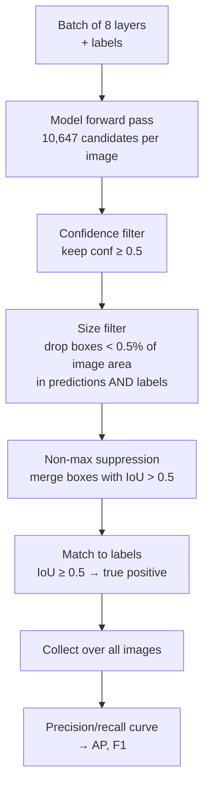
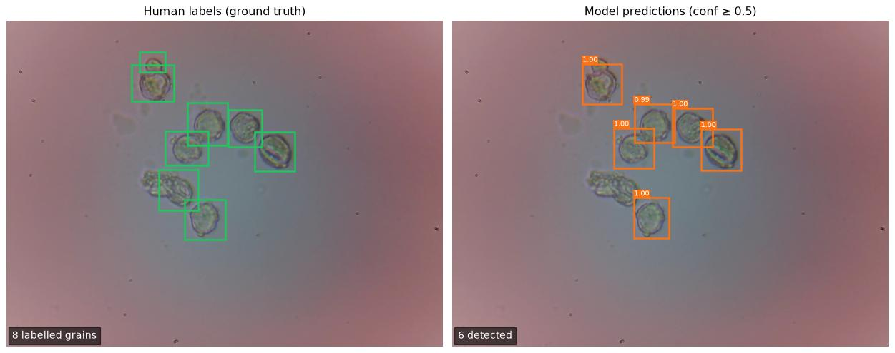

# 5. Evaluation and results

[← Training](04-training.md) · [Index](README.md) · [Next: Reproduce it →](06-reproduce.md)

Evaluation answers: **on images the model has never seen, how many pollen grains does it find, and how often is it wrong?** Script: [code/test.py](../code/test.py), function `evaluate()`.

```bash
cd code/
python test.py --weights_path ../weights/pollen_20190526.pth \
    --model_def config/yolov3-pollen.cfg \
    --data_config config/test_20190523.data --batch_size 8
```

## Results

Published weights `pollen_20190526.pth` (trained on 26 May 2019), tested on all 3,769 layers of 23 May 2019:

| Class | AP | F1 | |
|---|---|---|---|
| **pollen** | **0.899** | **0.875** | the meaningful result |
| maybe | 0.000 | 0.000 | not predictable by this model, see below |
| mean (mAP) | 0.450 | | average of both rows, pulled down by `maybe` |

True positives: 2,194. Full log: [results/test_20190523_per_layer.log](../results/test_20190523_per_layer.log). Run on Python 3.14, PyTorch 2.15, CPU only, about 30 minutes.

**In plain words:** on a day it was not trained on, the detector finds the large majority of the labelled pollen grains, and most of the boxes it draws are real pollen.

## The evaluation pipeline



### 1. Forward pass

The model outputs 10,647 candidate boxes per layer ([chapter 3](03-model.md)).

### 2. Confidence filter

Candidates with confidence below **0.5** (`--conf_thres`) are discarded. This removes almost all candidates, since most grid cells contain only background.

### 3. Size filter

Boxes smaller than **0.5% of the input area** (0.005 × 416² ≈ 865 px², about 29 × 29 px at 416, or about 113 × 113 px in the original image) are removed, **from both predictions and labels** (`target_area_threshold`). Very small objects are mostly dust, and the same rule on both sides keeps the comparison fair. In this run, **322 labelled boxes** were removed this way. The log reports this as "Number of targets removed".

### 4. Non-max suppression (NMS)

Neighbouring cells and anchors often all detect the same grain, giving a cluster of nearly identical boxes. NMS reduces each cluster to one box (`output_non_max_suppression`):

1. Sort the remaining boxes by confidence.
2. Take the most confident box; find all boxes that overlap it with IoU > **0.5** (`--nms_thres`).
3. Replace it by the **confidence-weighted average** of that group (this implementation averages instead of just keeping the top box, giving slightly more precise coordinates). Remove the rest of the group.
4. Repeat until no boxes are left.

**IoU (Intersection over Union)** = area of overlap ÷ area of union. 1.0 means two identical boxes, 0 means no overlap, and 0.5 means the boxes overlap substantially.

### 5. Matching predictions to labels

`get_batch_statistics` ([code/utils/utils.py](../code/utils/utils.py)), for each layer, goes through predictions from most to least confident. A prediction is a **true positive (TP)** if the layer has at least one label of the predicted class and the label it overlaps most has IoU ≥ **0.5** (`--iou_thres`) and hasn't been matched yet; otherwise it is a **false positive (FP)**. (The code checks the class at the layer level only, so a pollen prediction can match a `maybe` box if that is the best-overlapping label.) Each label can be matched only once, so two boxes on one grain give one TP and one FP. Labels left unmatched are **false negatives (FN)**, missed grains.

### 6. Metrics

Over all layers, the predictions are sorted by confidence. Walking down the list, precision and recall are computed after each prediction:

- **Precision** = TP / (TP + FP): "when the model says pollen, how often is it right?"
- **Recall** = TP / (number of labelled grains): "what fraction of the grains did it find?"

Lowering the confidence threshold finds more grains (higher recall) but also accepts more mistakes (lower precision). Plotting precision against recall gives a curve:

- **AP (average precision)** is the area under that curve (`compute_ap`, all-points interpolation as in the PASCAL VOC / py-faster-rcnn code). It summarises performance across all thresholds; 1.0 is perfect.
- **F1** = 2 × precision × recall / (precision + recall), at the operating point (confidence ≥ 0.5). It is high only if both precision and recall are high.
- **mAP** is the mean of the per-class APs.

## The `maybe` class

The labels contain two classes, `pollen` and `maybe` (686 boxes the labeller wasn't sure about), but the published network was built with `classes=1` ([yolov3-pollen.cfg](../code/config/yolov3-pollen.cfg)). It can only ever output class 0, *pollen*. Consequences:

- `maybe` gets AP 0 by construction. This is not a failure of the model.
- `maybe` boxes are ground truth for class 1 only, so they don't count as missed pollen: pollen recall is measured against the pollen labels.
- **mAP 0.45 is misleading**; it averages 0.90 with an unattainable 0. The pollen AP of **0.899** is the number that describes this detector.

## Looking at errors



This example (sample `060912`, layer 0) shows typical behaviour:

- Six well-separated grains are found with confidence ≈ 1.00, with boxes closely matching the labels.
- **Missed:** the crumpled, irregular grain on the left. It doesn't look like the typical round grain and is partly out of focus.
- **Missed:** the small object above the top grain. It is under the size threshold anyway, so the evaluation would discard that label.

Overall the hard cases are grains that are clumped or overlapping, deformed, or strongly out of focus, which are also the cases where human labellers disagree (hence the `maybe` class).

## Optional evaluation modes

`test.py` has extra flags beyond the default per-layer evaluation:

| Flag | What it does |
|---|---|
| `--merge` | **Per-sample evaluation.** All layers of a sample form one batch (`GroupSampler`). Labels from all layers are merged into one set, and a predicted grain is kept only if it is detected in at least 70% of the sample's layers. This counts each physical grain once instead of once per layer and suppresses detections that only appear in one or two layers. |
| `--save_images` | Saves every evaluated layer with predicted and labelled boxes drawn to `output/images/`. |
| `--intheloop` | Human-in-the-loop relabelling. Saves layers where the model disagrees with the labels to `output/relabel/` and fully correct ones to `output/correct/`, so a person can review whether the model or the label is wrong. |
| `--blur_thres X` | Drops predicted and labelled boxes whose image region is blurry, measured by the variance of the Laplacian (low variance = few sharp edges = blurry). |
| `--conf_thres`, `--nms_thres`, `--iou_thres` | The three thresholds described above (defaults 0.5, 0.5, 0.5). |

## Detecting pollen in new images

[code/detect.py](../code/detect.py) runs the model on any folder of images without labels and saves a copy of each with boxes drawn:

```bash
python detect.py --image_folder ../data/pollen_20190523/layers/ --output_folder ../output/detections/
```

It uses a stricter default confidence threshold of 0.8 (`--conf_thres`), which favours fewer false alarms over finding every grain.
