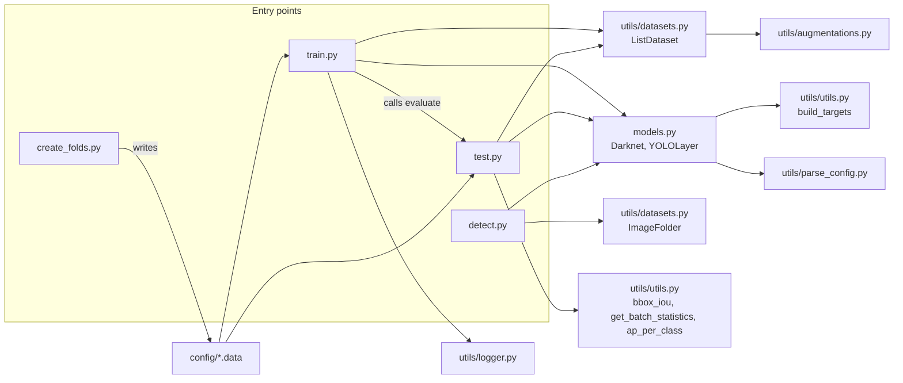

# 7. Code guide

[← Reproduce it](06-reproduce.md) · [Index](README.md)

A map of the repository and of every source file, for anyone who wants to read, change or extend the code.

## Repository layout

```
pollenpub/
├── README.md                 project overview, seminar context, setup
├── docs/                     this documentation
├── results/                  evaluation log of the reproduced run
├── code/                     all Python code (run scripts from here)
│   ├── train.py              training loop
│   ├── test.py               evaluation (AP, F1) and evaluation modes
│   ├── detect.py             run the model on any image folder, save drawings
│   ├── create_folds.py       build train/validation/test split files
│   ├── models.py             YOLOv3 network (Darknet), YOLO layer, loss
│   ├── requirements.txt      pip dependencies (modern setup)
│   ├── environment.yml       original 2019 conda environment (historical)
│   ├── config/
│   │   ├── yolov3-pollen.cfg            network architecture
│   │   ├── train_20190526fold{0-4}.data training/validation splits
│   │   ├── test_20190523.data           test set
│   │   └── pollen/classes.names         class names for detect.py
│   └── utils/
│       ├── datasets.py       image + label loading, padding, resizing
│       ├── utils.py          box maths, IoU, NMS, target assignment, AP
│       ├── augmentations.py  horizontal flip
│       ├── parse_config.py   readers for .cfg and .data files
│       ├── logger.py         CSV + TensorBoard logging
│       └── download.py       resumable, partial download from Zenodo
├── hwdesign/                 3D-printable parts of the trap and microscope
├── pollen_library/           description + loader for a related species dataset
├── weights/                  (downloaded) pretrained weights, not in Git
└── data/                     (downloaded) images and labels, not in Git
```

## How the pieces call each other



## File by file

### `models.py`: the network

| Name | Role |
|---|---|
| `create_modules(module_defs)` | Turns the parsed `.cfg` blocks into PyTorch layers: `convolutional` → Conv2d + BatchNorm + LeakyReLU, `upsample`, `route` and `shortcut` (placeholders handled in `forward`), `yolo` → `YOLOLayer` |
| `YOLOLayer` | One detection head. `forward` reshapes the raw output to `[batch, 3 anchors, grid, grid, 6]`, decodes boxes (sigmoid offsets + grid position, exponential × anchor size) and, if labels are given, computes the loss and training metrics |
| `YOLOLayer.compute_grid_offsets` | Precomputes cell indices and anchor sizes for a grid size; recomputed when the input size changes (multi-scale training) |
| `Darknet` | The full model. `forward` runs the layers in order, keeps every layer's output so `route`/`shortcut` can refer back, and concatenates the three heads' outputs |
| `Darknet.load_darknet_weights` | Reads original Darknet binary weights; stops after layer 75 for `darknet53.conv.74` (backbone only) |
| `Darknet.save_darknet_weights` | Writes the Darknet binary format |

### `utils/utils.py`: box maths and metrics

| Function | Role |
|---|---|
| `xywh2xyxy` | Centre/size → corner coordinates |
| `bbox_iou`, `bbox_wh_iou` | IoU of boxes; IoU of shapes only (for anchor matching) |
| `build_targets` | Training: assigns each label to one grid cell and anchor, builds the target tensors and masks ([chapter 4](04-training.md#3-assigning-labels-to-predictions-build_targets)) |
| `non_max_suppression` | Confidence filter + NMS with weighted box merging (used by `detect.py`) |
| `rescale_boxes` | Maps boxes from the 416×416 padded input back to original image pixels |
| `get_batch_statistics` | Marks each prediction as TP or FP against the labels |
| `ap_per_class`, `compute_ap` | Precision, recall, AP and F1 per class |
| `weights_init_normal` | Random initialisation |

### `utils/datasets.py`: data loading

| Name | Role |
|---|---|
| `pad_to_square`, `resize` | Preprocessing ([chapter 3](03-model.md#step-1-input-preprocessing)) |
| `ListDataset` | Reads a split file, loads each layer and its label file (path derived by replacing `layers`→`labels` and `.jpg`→`.txt`), converts labels to padded coordinates, applies flip augmentation and the optional blur filter |
| `ListDataset.collate_fn` | Stacks a batch, adds the image index to each label row, and picks a new random input size every 10 batches if multi-scale is on |
| `ImageFolder` | Loads every image in a folder without labels (for `detect.py`) |

### `test.py`: evaluation

| Name | Role |
|---|---|
| `evaluate(...)` | The evaluation pipeline ([chapter 5](05-evaluation.md#the-evaluation-pipeline)); also called by `train.py` after each epoch |
| `GroupSampler` | Batches all layers of one sample together (for `--merge`) |
| `output_non_max_suppression` | NMS with size filter and an optional "detected in at least N layers" rule |
| `target_area_threshold`, `target_non_max_suppression` | Size filter for labels; merging labels across layers |
| `save_images_to_disk` | Draws predictions and labels for `--save_images` / `--intheloop` |

### `train.py`, `detect.py`, `create_folds.py`

Covered in [chapter 4](04-training.md), [chapter 5](05-evaluation.md#detecting-pollen-in-new-images) and [chapter 2](02-dataset.md#train--validation--test-splits) respectively.

### Configuration files

- **`.cfg`** (Darknet format): a list of `[block]` sections with `key=value` lines. Read by `parse_model_config`. Only `width`, `height` and `channels` of `[net]` are used; the layer blocks define the architecture.
- **`.data`**: `classes`, `train`, `valid`, `base_dir` and `names`. Read by `parse_data_config`. Paths are relative to `code/`.

## Changes made for modern software

The original code (2019) targeted Python 3.7, PyTorch 1.x and CUDA 10.1, and no longer ran on current systems. As part of this seminar project it was ported and verified on Python 3.12 / 3.14 with PyTorch 2.15. The published weights load unchanged (all 438 tensors match). All changes:

| File | Change | Why |
|---|---|---|
| `models.py` | Skip object/coordinate/class loss terms when a batch has no labels | Mean over an empty set is NaN and corrupted training (common: 47% of layers have no pollen) |
| `utils/utils.py` | Clamp grid cell indices in `build_targets` | A box centred exactly on the image edge indexed one cell outside the grid |
| `detect.py`, `test.py` | `np.where(...)[0][0]` instead of `int(np.where(...)[0])` | Converting a 1-element array to `int` this way fails in NumPy 2 |
| `utils/datasets.py`, `detect.py` | Convert images to RGB on load; corrected label offset for odd padding; removed a debug image write | Greyscale/RGBA images crashed the loader; the old code shifted box corners by one pixel; the debug write failed when `../output/tmp/` didn't exist |
| `train.py` | Boolean flags parsed properly; keep only last + best checkpoint; `--max_batches`; log mean epoch loss; `pin_memory` only with a GPU | `--multiscale_training False` was treated as true; one 246 MB checkpoint per epoch filled the disk; quick smoke tests on CPU |
| `utils/logger.py` | Replaced unmaintained `tensorboard_logger` with PyTorch's `SummaryWriter` (optional) plus a CSV log | Old package no longer installs |
| `create_folds.py` | Replaced removed pandas APIs (`DataFrame.append`, `to_csv(sep='\n')`); fixed missing `num_pollen` column | Script crashed on pandas 2 |
| `utils/download.py` | Rewritten: HTTP range requests, resume on errors, `--only` for partial extraction, no stored zip | Zenodo drops long downloads; the old script needed twice the archive size in free disk space |
| `requirements.txt`, README | pip-based setup instructions | The conda environment no longer resolves |

## Known limitations

- **One class only.** The model can't distinguish `maybe` from `pollen`, nor pollen species. Species classification would need a second stage, for example trained on the [pollen library](../pollen_library/readme.md) dataset.
- **Per-layer counting.** The default evaluation counts a grain once per layer it appears in. For actual pollen counts, `--merge` (per-sample) is the relevant mode.
- **Model size.** At 246 MB and about 0.45 s per image on a laptop CPU, the model is too heavy for a microcontroller in the trap itself; images would have to be sent to a server, or a smaller detector trained.
- **Training with `maybe` labels.** The network has one class output, so label files used for training should contain only class `0`.

## Licence and credits

- Repository: MIT licence, © 2019 osaukh (see [LICENSE](../LICENSE)). Several source files carry GPLv3 headers from the PyTorch-YOLOv3 code they are derived from.
- Paper, hardware, dataset and trained model: Nam Cao, Matthias Meyer, Lothar Thiele, Olga Saukh, *Automated Pollen Detection with an Affordable Technology*, EWSN 2020.
- YOLOv3: Joseph Redmon, Ali Farhadi. PyTorch implementation: Erik Linder-Norén.
