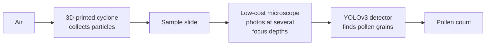
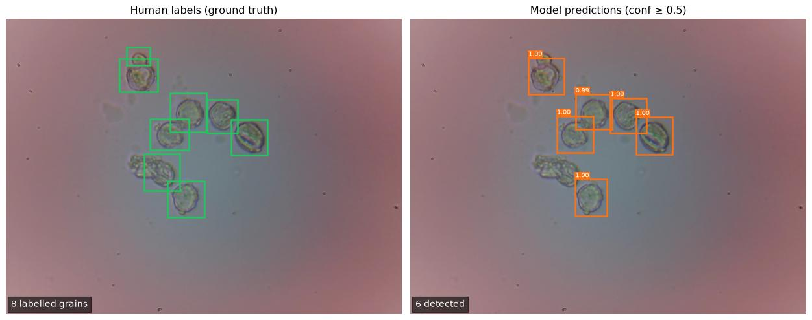

# Project documentation

This folder explains, end to end, how this automated pollen detector works: from the 3D-printed trap that collects pollen from the air, through the microscope images, to the neural network that finds the pollen grains and the numbers that measure how well it does.

The project reproduces the EWSN 2020 paper *Automated Pollen Detection with an Affordable Technology* (Cao, Meyer, Thiele, Saukh) and was carried out as a seminar project in Advanced Networked Embedded Systems. See the [main README](../README.md) for what was original work and what was added.

## The project in two minutes

People with hay fever rely on pollen forecasts, and those forecasts rely on pollen counts. Traditionally these come from expensive volumetric traps whose sticky tape is collected by hand and counted by a trained person under a microscope, days after the fact. This project replaces the manual steps with cheap hardware and a neural network:

- **Hardware:** a fan pulls air through a 3D-printed cyclone, which throws particles onto a sample surface. A low-cost camera microscope photographs it.
- **Images:** pollen grains are 3D and the microscope has a shallow depth of field, so each spot is photographed at several focus depths (a *focus stack*, 2 to 26 *layers*).
- **Detection:** a YOLOv3 object detector looks at each layer and draws a box around every pollen grain.
- **Result:** on 3,769 test images from a day the model never saw during training, it reaches **AP 0.899 and F1 0.875** for pollen.

*Left: the boxes a person drew. Right: what the model finds, with its confidence. It finds 6 of the 8 grains and misses a very small grain at the top and the crumpled grain at the left.*

## Reading guide

| # | Chapter | What you learn |
|---|---|---|
| 1 | [System and hardware](01-system-and-hardware.md) | The problem, the physical trap, and how the parts fit together |
| 2 | [Dataset](02-dataset.md) | Focus stacks, file layout, label format, train/test splits |
| 3 | [The model](03-model.md) | How YOLOv3 turns an image into boxes: backbone, grids, anchors, decoding |
| 4 | [Training](04-training.md) | Loss function, optimizer, augmentation, cross-validation folds |
| 5 | [Evaluation and results](05-evaluation.md) | Filtering, non-max suppression, matching, AP/F1, and what the numbers mean |
| 6 | [Reproduce it yourself](06-reproduce.md) | Step-by-step commands, runtimes and troubleshooting |
| 7 | [Code guide](07-code-guide.md) | Every file and function, plus what was changed to run on modern software |

**Short on time?** Read this page, then [chapter 5](05-evaluation.md) for results and [chapter 6](06-reproduce.md) to run it.
**New to object detection?** Read chapters 2 → 3 → 5 in order; each one explains its terms the first time they appear.

## Glossary

| Term | Meaning |
|---|---|
| **Layer** | One photo of a sample at one focus depth (e.g. `060912-03.jpg` is layer 3 of sample `060912`) |
| **Sample / stack** | All layers taken at one spot on the slide; identified by the number before the dash |
| **Bounding box** | Rectangle around an object, stored as centre x, centre y, width, height |
| **IoU** | Intersection over Union: the overlap of two boxes, from 0 (none) to 1 (identical) |
| **Confidence** | The model's estimate (0 to 1) that a box contains an object |
| **NMS** | Non-max suppression: removes duplicate boxes for the same object |
| **Precision** | Of the boxes the model drew, the fraction that are real pollen |
| **Recall** | Of the real pollen, the fraction the model found |
| **AP** | Average precision: area under the precision/recall curve, 0 to 1 |
| **F1** | Harmonic mean of precision and recall |
| **Anchor** | One of 9 preset box shapes the model adjusts instead of predicting boxes from scratch |
| **Fold** | One split of the data for cross-validation |
